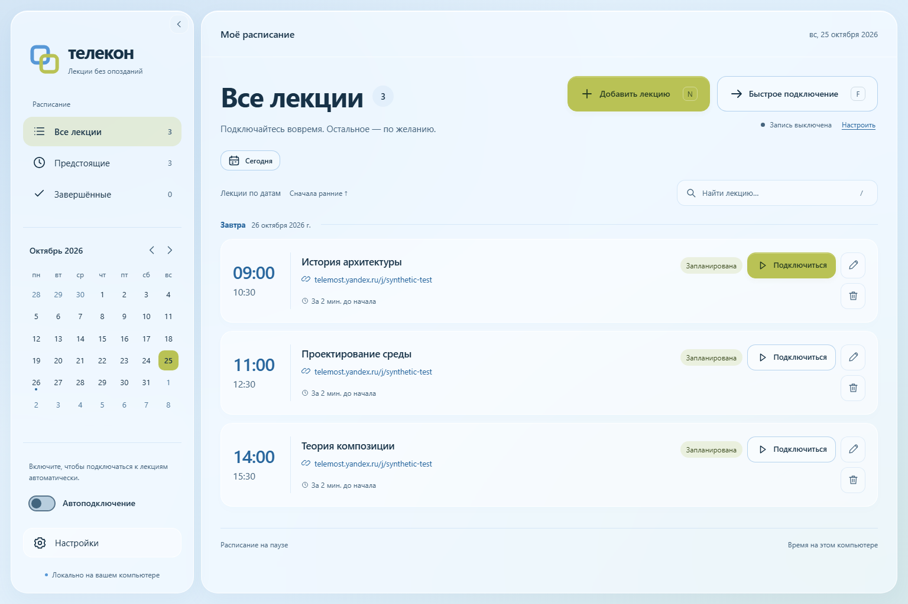
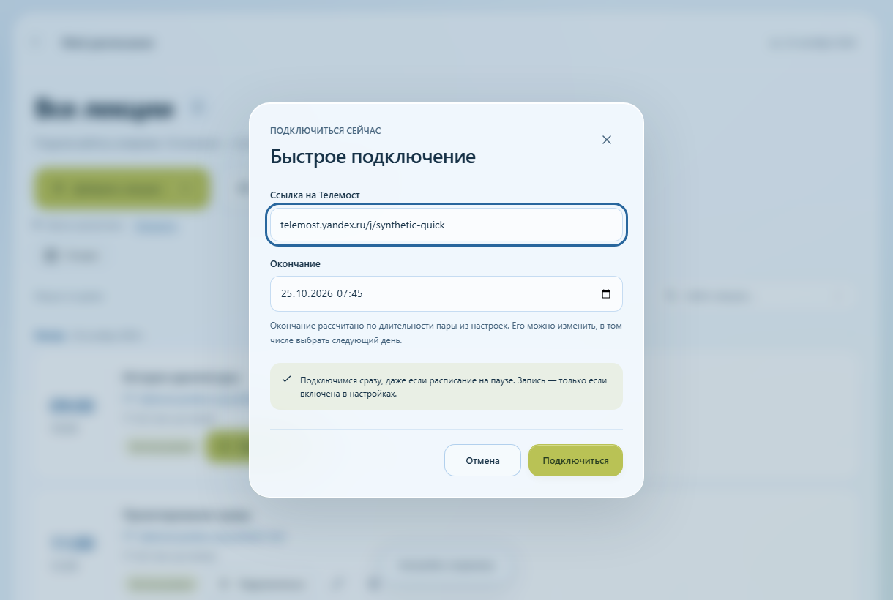
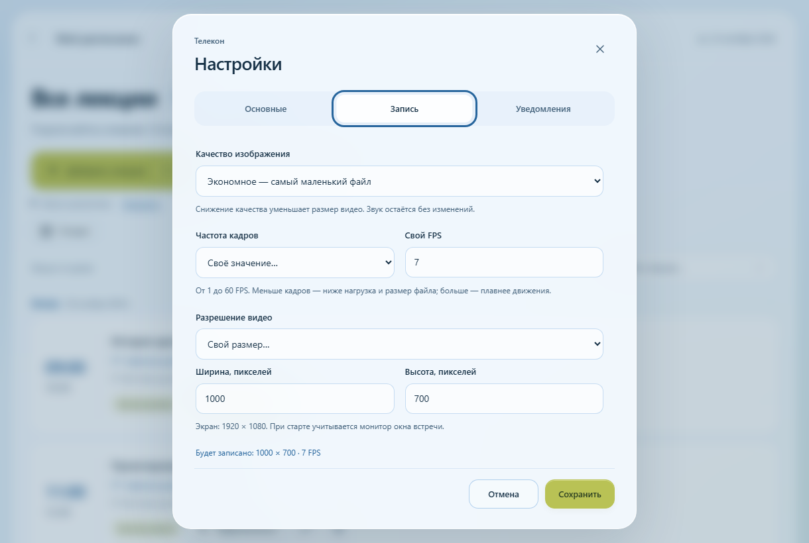

# Телекон

**Лекции по расписанию. Быстрое подключение. Запись по желанию.**

Телекон помогает вовремя подключаться к встречам в Яндекс Телемосте.
Добавьте ссылку и время — приложение откроет встречу к началу пары.
Если нужно подключиться прямо сейчас, достаточно ссылки и времени окончания.

[Скачать из релизов](https://github.com/tatpow/telecon/releases) ·
[Как пользоваться](docs/USER_GUIDE.md) ·
[Сообщить о проблеме](https://github.com/tatpow/telecon/issues/new/choose)

*На скриншотах — настоящий интерфейс и демонстрационные лекции.*

## Начать за три шага

1. **Запустите приложение.** В Windows распакуйте весь архив и откройте
   `Telecon.exe`. Python, OBS и отдельный аудиокабель для готовой сборки не нужны.
   Рядом с EXE должны остаться остальные файлы из архива. Нужен
   [Microsoft Edge WebView2 Runtime](https://developer.microsoft.com/en-us/microsoft-edge/webview2/).
2. **Войдите в Яндекс.** Откройте **Настройки → Основные → Войти в Яндекс**.
   Авторизуйтесь в появившемся браузере и закройте его.
3. **Добавьте встречу.** Нажмите **Добавить лекцию**, укажите название, ссылку
   и время. Включите **Автоподключение** в боковой панели. Для встречи прямо
   сейчас используйте **Быстрое подключение**.

Ссылку можно вставить без `https://`, например `telemost.yandex.ru/j/…`.
Микрофон и камера при автоматическом входе выключаются; включить их можно
самостоятельно в окне встречи.

## Всё нужное рядом

| Задача | Как помогает Телекон |
|---|---|
| Не пропустить пару | Календарь, поиск, фильтры и автоматическое подключение |
| Подключиться сейчас | Ссылка и время окончания в быстром подключении |
| Сохранить лекцию | Отдельный тумблер записи в **Настройки → Запись** |
| Уменьшить размер видео | Качество, FPS от 1 до 60 и разрешение, включая свои значения |
| Подобрать имя файла | Шаблон вроде `{name}-{date}-{duration}` с предварительным просмотром |
| Убрать лишнюю карточку | Удаление только из календаря либо вместе с видео, с подтверждением |
| Освободить место в окне | Сворачиваемая боковая панель и клавиши **N**, **F**, **/** |

Интерфейс использует светлые стеклянные поверхности, фисташковые акценты
и мягкие анимации. При включённом уменьшении движения в системе эффекты
отключаются. Сочетания клавиш не мешают вводу текста.

<strong>Посмотреть быстрое подключение и настройки записи</strong>

## Запись — только когда она нужна

По умолчанию Телекон **только подключается**. Чтобы сохранять видео в Windows,
включите **Настройки → Запись → Записывать лекции**. Изменение действует
со следующей встречи и не прерывает текущую.

Доступны MKV и MP4. Можно задать минимальную длительность: слишком короткое
видео не сохранится, а причина появится на карточке. При значении `0`
ограничения нет.

Если свернуть окно Телемоста во время записи, звук продолжится, а вместо
изображения будет чёрный кадр. Можно включить мягкий звуковой сигнал,
уведомление Windows и значок на иконке приложения; каждый вариант
настраивается отдельно.

## На каких системах работает

| Система | Подключение и календарь | Запись |
|---|---|---|
| **Windows 11 · x64** | Основная проверяемая платформа | Да |
| **Ubuntu / Linux Mint / Fedora · x64** | Экспериментальная поддержка | Пока нет |
| **macOS · Apple Silicon и Intel** | Экспериментальная поддержка | Пока нет |

Для Linux и macOS подготовлены нативные сборки через GitHub Actions.
Наличие workflow не означает, что конкретная сборка уже прошла:
проверяйте статус запуска и его артефакты в
[Actions → Native builds](https://github.com/tatpow/telecon/actions/workflows/build.yml).
Они хранятся 3 дня. Опубликованные архивы находятся в
[Releases](https://github.com/tatpow/telecon/releases).

[Сборка из исходников: Linux → Windows 11 → macOS](BUILDING.md).

## Полезно знать

- Для автоподключения приложение должно оставаться запущенным, а компьютер —
  включённым и бодрствующим. Окно Телекона можно свернуть. В Windows
  настройка защиты от сна помогает во время расписания и встреч.
- Календарь, настройки и профиль входа хранятся на вашем компьютере.
  Не отправляйте папку профиля или базу лекций в публичные Issues.
- По умолчанию видео попадает в **Видео/Telecon**; папку можно изменить.
  Удаление карточки из календаря само по себе не удаляет видео.
- Если Телемост изменит интерфейс входа, автоматическое подключение может
  потребовать обновления. При ошибке Телекон сообщает о ней.

Подробности о настройках, именах файлов и данных —
в [руководстве пользователя](docs/USER_GUIDE.md).

## Помочь проекту

Проект в основном ведёт один автор. Сообщения об ошибках, идеи и небольшие PR
приветствуются — в том числе с помощью ИИ.
Прочитайте [CONTRIBUTING.md](CONTRIBUTING.md), чтобы начать.

Телекон — **vibecode / GVP (Generated Viable Product)**:
основная реализация создана ИИ под руководством человека.
Это описание способа разработки, а не сертификат качества.
[О концепции GVP](https://github.com/tatpow/GVP).

[Инструкции для разработки](AGENTS.md) · [Проверки](CHECKS.md) ·
[Дизайн](DESIGN.md) · [Изменения версии](RELEASE_NOTES.md) ·
[Лицензия AGPL-3.0](LICENSE)